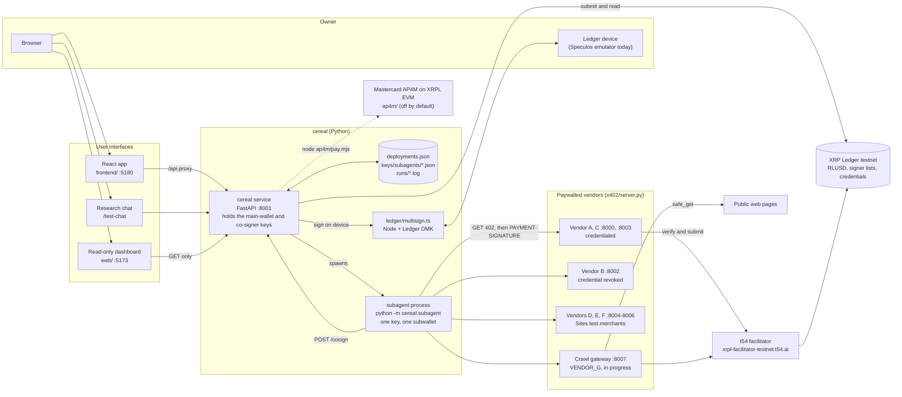
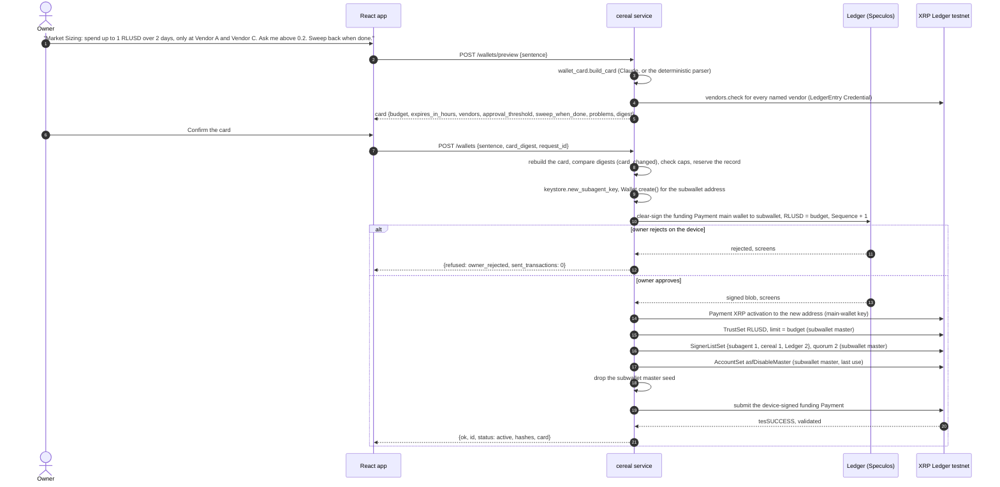
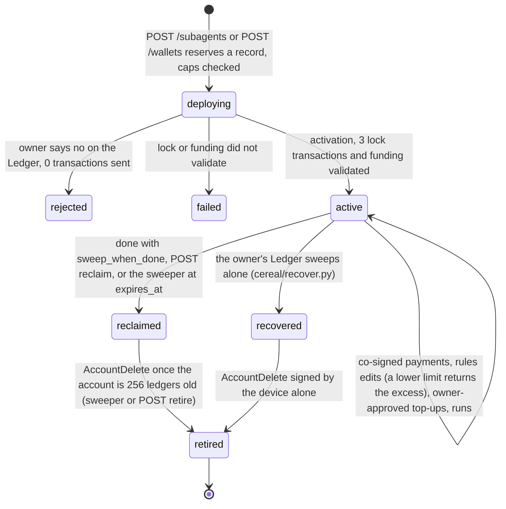
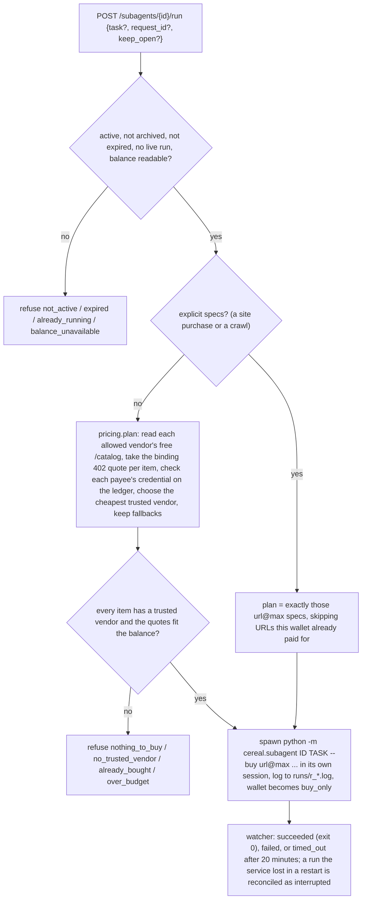
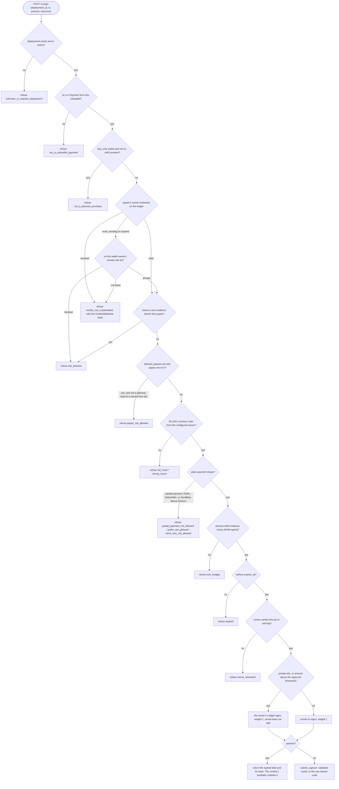
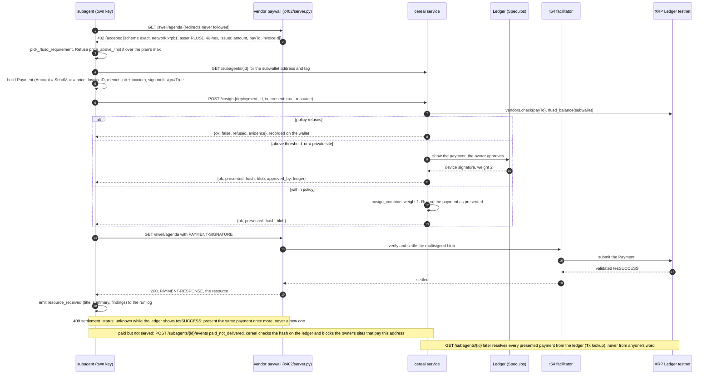
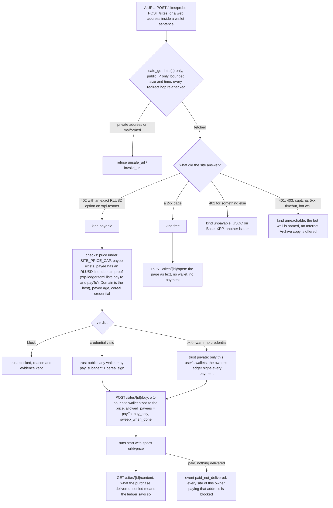
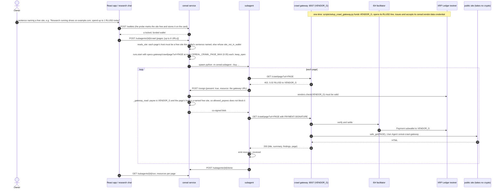
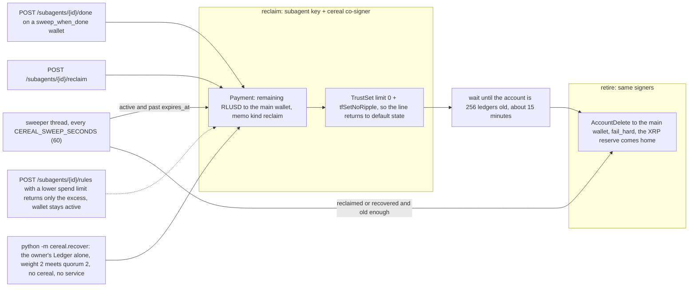

# cereal

**Disposable, budget-exact wallets for AI agents on the XRP Ledger.** One plain-English sentence becomes a wallet that holds exactly its budget, is locked by the ledger so no single key can spend, pays only vendors that hold a public on-ledger credential, and is deleted at the end into an accounting export.

Built at the XRPL Commons **AI & Fintech XRP Ledger Hackathon**, New York, Oct 24–25 2026. Agentic Finance track. Everything runs on **XRPL testnet** (`xrpl:1`); every primitive used is live on mainnet today.

> Every rule is a ledger object, not a policy file. The budget is a balance. The lock is a 2-of-2 signer list with the master key disabled. Vendor trust is a revocable XLS-70 credential. The audit tag is a memo. Disposable means `AccountDelete`.

---

## Contents

1. [Why](#why)
2. [What cereal enforces, and with what](#what-cereal-enforces-and-with-what)
3. [System map](#system-map)
4. [Who holds which key](#who-holds-which-key)
5. [How it is supposed to work (flowcharts)](#how-it-is-supposed-to-work)
   - [A wallet from one sentence](#1-a-wallet-from-one-sentence)
   - [The ledger objects behind every wallet](#2-the-ledger-objects-behind-every-wallet)
   - [Wallet lifecycle](#3-wallet-lifecycle)
   - [Running a task: planning and the subagent process](#4-running-a-task-planning-and-the-subagent-process)
   - [The co-sign policy](#5-the-co-sign-policy-every-check-before-cereal-signs)
   - [Buying over x402](#6-buying-a-resource-over-x402)
   - [Sites: give cereal any URL](#7-sites-give-cereal-any-url)
   - [The crawl gateway (in progress)](#8-the-crawl-gateway-in-progress)
   - [Reclaim, retire, the sweeper, and owner recovery](#9-reclaim-retire-the-sweeper-and-owner-recovery)
6. [What a hijacked agent gets](#what-a-hijacked-agent-gets)
7. [Repository layout](#repository-layout)
8. [Service API](#service-api)
9. [Running it locally](#running-it-locally)
10. [Configuration](#configuration)
11. [Tests](#tests)
12. [Verified on testnet](#verified-on-testnet)
13. [Partner integrations](#partner-integrations)
14. [Things we learned the hard way](#things-we-learned-the-hard-way)
15. [Documentation index](#documentation-index)

---

## Why

AI agents already make hundreds of thousands of payments a day on the XRP Ledger, from wallets built for humans: one seed, one balance, every vendor reachable. They cannot spot a scam, they repeat mistakes at machine speed, and one hijacked agent drains everything it can see.

Every "agent wallet" on the market answers this with a policy file or a server that co-signs. A prompt injection talks around a policy file. A server in the hot path is a custodian.

cereal's answer: give each agent task its own wallet, funded with exactly its budget, locked on the ledger so that

- the agent **cannot pay alone** (`tefBAD_QUORUM`),
- cereal **cannot pay at all** (it only co-signs, and never holds a budget),
- the owner's **Ledger device can always take the money back without cereal**,
- the agent **cannot spend what it was not given** (`tecPATH_PARTIAL`),
- and the worst case, even if cereal itself is compromised, is **one task's budget**.

## What cereal enforces, and with what

| Rule | Ledger object | What it stops |
|---|---|---|
| How much | the subwallet's RLUSD balance, funded with exactly the budget; trust-line limit = budget | overspending (`tecPATH_PARTIAL`), receiving more than the budget |
| Who can sign | `SignerListSet` {subagent 1, cereal 1, owner's Ledger 2}, quorum 2, then `AccountSet` asfDisableMaster | the agent alone (`tefBAD_QUORUM`), cereal alone, the old master key (`tefMASTER_DISABLED`) |
| Whom it may pay | a `cereal:vendor:data` Credential (XLS-70) on the vendor, read from the ledger by the co-signer before every signature; `CredentialDelete` revokes for everyone | paying a vendor one customer already caught |
| Attribution | `SourceTag` + `Memos` `{tag: hmac, job, kind}` on every transaction | untraceable spend |
| Until when | `expires_at` on the record (co-signer rule) and `LastLedgerSequence` on every transaction | stale transactions, zombie wallets |
| Human in the loop | the funding `Payment` is clear-signed on the owner's Ledger before anything touches the ledger; payments above a threshold need the device too | budgets nobody approved |
| Disposable | `Payment` remainder home, `TrustSet` to zero, `AccountDelete` with the reserve to the main wallet | leftover attack surface |

Two rules are enforced by the co-signer rather than the ledger (vendor class, expiry). The budget, the two-key lock, the recovery key and the deletion are the ledger's.

## System map



Three kinds of process, three kinds of trust:

- **The cereal service** (`cereal/service.py`) is the only process that holds the main-wallet key and the co-signer key. It creates and funds subwallets within company caps, co-signs only `Payment`s from subwallets it created and only after its policy passes, and runs a sweeper that returns leftovers.
- **A subagent** (`cereal/subagent.py`) is one process per task with one key that is a weight-1 signer on its own subwallet and nothing else. It can build and sign payments; it cannot submit anything the ledger will accept without a second signature.
- **The planner** (the React app, the research chat, or `cereal/main_agent.py`) holds **no keys**. A hijacked planner can at most ask the service to deploy within the caps.

The LLM (Claude Haiku 5.5 via OpenRouter, Anthropic as fallback, or off) only **reads and proposes**: it turns a sentence into a card, picks catalog items, interprets a rules edit. Every limit is enforced by cereal and the ledger, so a wrong or manipulated answer cannot move money past them.

## Who holds which key

| Key | Held by | Can | Cannot |
|---|---|---|---|
| Main wallet (`TREASURY`) | the cereal service (software key); the owner's Ledger is on its signer list | activate and fund subwallets, within caps and after device approval | spend from any subwallet |
| Subagent key | its own process, from `keys/subagents/<id>.json` (mode 600) | sign a `Payment` from its subwallet as a weight-1 signer | move a drop alone (`tefBAD_QUORUM`); touch the main wallet or another subwallet |
| Co-signer (`CEREAL_COSIGN`) | the cereal service | add the second weight-1 signature after policy | spend alone; it never holds a budget |
| Owner's Ledger (`LEDGER_ADDRESS`) | the owner; Speculos emulator in the demo | approve each budget, approve payments above the threshold, sweep and delete a subwallet **alone** (weight 2 meets quorum 2) | anything it does not clear-sign on screen |
| Subwallet master | nobody | the three lock transactions, once | anything after `asfDisableMaster`; the seed is dropped from memory |
| `CREDENTIAL_ISSUER` | cereal | issue and revoke `cereal:vendor:*` credentials | spend |
| Vendor keys (`VENDOR_A`…`VENDOR_G`) | the vendors (ours, for the demo) | accept a credential, receive payments | — |

## How it is supposed to work

### 1. A wallet from one sentence

The owner types a sentence. cereal compiles it into a **card** that says exactly what will be enforced. The owner confirms the card, approves the budget on the Ledger, and only then does anything reach the ledger.



Details that matter:

- **The card is rebuilt server-side.** A client's copy of the card is never trusted. With `card_digest`, a card that differs from the one the owner reviewed (a vendor revoked since, a cap changed, a different parser reading) is refused `card_changed` and nothing is sent.
- **Caps are enforced only in the service**, never by a planner: `MAX_SUBAGENT_BUDGET`, `MAX_OUTSTANDING_BUDGET`, `MAX_ACTIVE_SUBAGENTS`. The cap check and the `deploying` record are one locked write, so two concurrent deploys cannot both pass a stale count.
- **Idempotent.** A `request_id` is on the record from its first write. A repeat returns the first outcome (`replayed: true`), a concurrent twin gets `in_progress`, a repeat with different terms is refused `request_id_reused`. A deploy that crashed after touching the ledger stays `deploy_interrupted` and is never retried.
- **The device sees the exact address.** The subwallet keypair is generated before the owner approves, so the screen shows the address that will be funded. The funding payment is signed first (Sequence + 1) and submitted last, after the lock, so a rejected budget sends zero transactions.
- **The lock is sequential**, three transactions, about 12 seconds. The single `Batch` form returned outer `tesSUCCESS` with all inner transactions rolled back on testnet, so the state check (`is_locked`) decides, never the outer result.

### 2. The ledger objects behind every wallet

```mermaid
flowchart LR
    act["Payment XRP<br/>main wallet to new address<br/>reserve_base + 2 x reserve_inc + 0.5<br/>signer: main-wallet key"] --> ts["TrustSet RLUSD<br/>limit = budget<br/>signer: subwallet master"]
    ts --> sl["SignerListSet quorum 2<br/>subagent 1, cereal 1, Ledger 2<br/>signer: subwallet master"]
    sl --> acs["AccountSet asfDisableMaster<br/>signer: subwallet master, last use"]
    acs --> fund["Payment RLUSD = budget<br/>main wallet to subwallet<br/>signer: owner's Ledger, clear-signed"]
    fund --> pay["Payment RLUSD to a vendor<br/>SourceTag + memo {tag, job, kind pay}<br/>signers: subagent + cereal, or subagent + Ledger"]
    pay --> rec["Payment remainder to main wallet<br/>TrustSet limit 0 + tfSetNoRipple"]
    rec --> del["AccountDelete to main wallet<br/>fail_hard, account 256+ ledgers old"]
```



Every transaction goes through `cereal/ledger.py`, which stamps `SourceTag` (2610250032, the hackathon's tag) and a memo `MemoType: cereal/job`, `MemoData: {"tag": "<hmac>", "job": "<deployment id>", "kind": "activate|lock|fund|pay|reclaim|retire|recover|return"}`, sets an explicit fee sized for the number of signers, and sets `LastLedgerSequence` ≈ current + 75 (about five minutes; 150 when a human must press a button). Submission goes through `submit_capture`, which returns `tef*`/`tem*`/`tel*` refusals instantly as results and waits for validation only when the result can still validate. **Refusals are results, never exceptions**, and nothing is ever claimed settled without a validated hash.

The tag is the first 32 hex characters of HMAC-SHA256(`CEREAL_TAG_HMAC_KEY`, `team|project|task`). Plain-text names never go on-chain; cereal keeps the mapping for the export.

### 3. Wallet lifecycle



`archived` is a presentation flag on top of this, set through `POST /subagents/{id}/meta`. It never moves funds, never changes `status`, and a retired account cannot be "restored" by flipping it.

### 4. Running a task: planning and the subagent process

Creating a wallet never starts its task. `POST /subagents/{id}/run` does, once per call, never while a run is live.



- The plan is made from **real quotes**: an unpaid GET of each item answers 402 with the binding price. Catalog prices are untrusted hints. The LLM may only name catalog items; the money is computed here.
- Once a run starts, the wallet is `buy_only`: cereal co-signs only x402 purchases from its plan, never a direct `pay()`. A model once paid a vendor for nothing; this closed that door on both sides.
- The subagent runs in its own session so a Ctrl-C on the service never kills it mid-payment. One live run per wallet; starts are serialised; a lost HTTP response replays by `request_id` instead of buying twice.
- `succeeded` means the process exited cleanly, not that every purchase went through. The payments and refusals it caused are on the wallet record with ledger evidence.

### 5. The co-sign policy: every check before cereal signs

This is `_cosign_deployment` in `cereal/service.py`. Every refusal is recorded on the wallet with its evidence and sends nothing.



The approval threshold is the **lower** of the wallet's own threshold and the company default (`CEREAL_APPROVAL_THRESHOLD`). A payment to a **private** site goes to the device whatever the amount: cereal never co-signs for a payee without a credential. Nothing off-chain can widen trust; an owner's private list only lets the owner's own key decide, and an owner's evidence (a vendor that took money without delivering) only ever narrows.

### 6. Buying a resource over x402

A subwallet is 2-of-2, so the stock x402 client (one wallet signs) cannot pay from it. The subagent builds the same `Payment` the client would, signs as one multisig signer, asks cereal to co-sign in **present** mode, and hands the combined blob to the vendor, whose facilitator (t54) verifies and submits it.



RLUSD must be named by its 40-hex currency code (`524C5553440000…`); the facilitator rejects the symbol. A 402 body is vendor data: parsed, bounded, never obeyed.

### 7. Sites: give cereal any URL

A user types a URL. cereal looks at it, decides whether an agent may reach it and who has to sign, then reads it (free) or buys it (x402). Nothing is paid or signed until the user asks. Full contract: [docs/SITES.md](docs/SITES.md).



Sessions are per user (`POST /session {name}` returns a bearer token shown once). Sites and the wallets bought for them are scoped to the user: another user's site id is a 404, anonymous `/sites` is 401. Promotion of a private site to a public credential is a cereal review step, never automatic.

### 8. The crawl gateway (in progress)

**The problem.** Most of the web takes no crypto. An agent that needs to read nike.com or a news site has nothing to pay and nobody to pay. **The gateway** is a credentialed cereal vendor (`VENDOR_G`, "Crawl gateway") that reads a public page for an agent and charges per page over x402 in RLUSD. The agent pays the gateway, never the site, and the gateway reads the page through the same SSRF-guarded fetch the Sites probe uses.



**Where it stands (Oct 25, uncommitted in the working tree):**

| Piece | File | State |
|---|---|---|
| Gateway account: faucet-funded, RLUSD line, credential issued and accepted | `scripts/setup_crawl_gateway.py` | written; `VENDOR_G` exists in `.env` |
| Gateway server mode: `X402_GATEWAY=1`, paid `GET /crawl/page?url=…`, reads the page after settlement | `x402/server.py`, `make crawl-gateway` | written |
| Config: `CEREAL_CRAWL_GATEWAY` (default `http://localhost:8007`), `CEREAL_CRAWL_PAGE_MAX` (0.05) | `cereal/config.py` | written |
| Directory: `VENDOR_G` listed as "Crawl gateway" in `GET /vendors` | `cereal/directory.py` | written |
| Co-sign exception: a wallet that named a free site may pay the gateway for that site's pages and nothing else | `cereal/service.py` (`gateway_page`, `reads_site`, `_gateway_read`) | written |
| Start a crawl: `POST /subagents/{id}/crawl {pages}` → run with gateway specs | `cereal/routes/runs.py` | written |
| Chat UI: a message with a web address shows a crawl | `frontend/src/siteCrawl.ts`, `frontend/src/LiveResearchChat.tsx` | **scripted**: only the probe is live; pages and fees are sample data and say so; it does not yet call `/subagents/{id}/crawl` |
| Live verification on testnet | — | **not yet run** |

The trust story is unchanged by the gateway: the gateway is a vendor like any other (credentialed, revocable with one `CredentialDelete`), the budget is still the subwallet's balance, and the co-signer only widens `allowed_payees` to the gateway for pages of a site the owner's own sentence named as free. The page content comes back as data, never as instructions.

### 9. Reclaim, retire, the sweeper, and owner recovery



The trust line must be closed with limit 0 **and `tfSetNoRipple`**, or it survives in a non-default state and `AccountDelete` fails with `tecHAS_OBLIGATIONS`. `AccountDelete` is submitted with `fail_hard` so a `tec` result returns at once instead of being relayed.

## What a hijacked agent gets

These are the demo beats, each a real refusal code on testnet (`make beats`, `python -m cereal.beats stolen-keys <id>`):

| Attack | Where it stops | Code |
|---|---|---|
| A planted instruction tells the subagent to pay an attacker's address | the co-signer: no credential | `vendor_not_credentialed` (status `none`) |
| The subagent goes rogue, signs alone and submits | the ledger: one signature below quorum | `tefBAD_QUORUM` |
| Attacker has **both** the subagent key and cereal's co-signer key, drains the subwallet | the ledger: the balance is the budget | `tecPATH_PARTIAL`, balance unchanged |
| Same attacker spends from the main wallet | the ledger: not signers there | `tefBAD_SIGNATURE` |
| A vendor overcharged or did not deliver | one public `CredentialDelete` by cereal's issuer blocks it for every customer | `vendor_not_credentialed` with the revocation hash |
| A site takes a payment and answers 500 | the delivery check | `paid_not_delivered` event, site blocked for that owner |
| cereal disappears | the owner's Ledger sweeps and deletes the subwallet alone | device-only `tesSUCCESS` |

## Repository layout

```
cereal/                  the Python package: the service, the co-sign policy, the subagent, the ledger primitives
  service.py             FastAPI :8001: deploy, wallets, cosign, reclaim/retire, sweeper, events, export, vendors, AP4M
  ledger.py              client, explicit fee + LastLedgerSequence, SourceTag + memos, submit_capture, multisign helpers
  subwallets.py          activation Payment -> sequential lock -> drop the master seed
  lock.py                TrustSet -> SignerListSet {agent 1, cereal 1, Ledger 2} q2 -> AccountSet asfDisableMaster; is_locked
  fund.py                the funding Payment (software path and the device path share one shape)
  pay.py                 agent-side Payment build + multisign; x402 Payment build; the tefBAD_QUORUM reproduction
  burn.py                reclaim (sweep + TrustSet 0) and retire (AccountDelete fail_hard); burnable_in
  deployments.py         the wallet records (deployments.json): atomic writes, machine-wide lock, caps, reserve, idempotency
  keystore.py            one ed25519 key per subagent in keys/subagents/<id>.json (mode 600)
  subagent.py            one process per task: budget_left, pay, buy (x402), buy_ap4m, done, prove_lock, hijack beat
  runs.py                POST /run: quote-based plan, spawn the subagent, watch it, reconcile after restarts
  pricing.py             catalogs, binding 402 quotes, on-ledger credential checks, cheapest trusted vendor, budget sizing
  wallet_card.py         sentence -> card (Claude or fallback parser), digest, request_id guard; recognises URLs as sites
  rules.py, rule_intent.py   edit a wallet's rules from fields or a sentence; a lower limit returns the excess on-ledger
  topup.py               owner-approved funding: device first, trust-line raise, then the device-signed Payment
  vendors.py             XLS-70: issue / accept / revoke / check; revocation evidence from the issuer's history
  directory.py           the vendor directory GET /vendors (A, B, C, G) with credential state, paid and refused counts
  device.py, recover.py  the Ledger as a multisig signer (via ledger/); the owner's device-only recovery
  sites_probe.py         Sites step 1: safe_get (SSRF guard), probe, checks, verdict, trust hint, bot-wall detection
  site_registry.py       Sites step 2: each user's private list, trust tiers, evidence blocks
  site_access.py         Sites step 3: open a free page, buy a payable one, read back what was delivered
  owners.py, sidestore.py   per-user sessions (hashed bearer tokens) and the small JSON stores beside the record file
  events.py, books.py    the security log; export rows and totals across wallets and rails
  chat.py, research_chat.py, llm.py   one message -> rules -> subagent -> sweep; the read-only chat planner; the model layer
  main_agent.py          the CLI planner: goal + envelope -> subagents -> reclaim (holds no keys)
  ap4m.py, beats.py, vendortest.py, preflight.py, demo.py, compiler.py, agent.py, cosign.py, jobs.py, export.py
                         the Mastercard rail driver, demo beats, live vendor-list proof, preflight, and the Part 0 single-job path
  routes/                feature routers the React app calls: runs (+ crawl), rules, funding, workspace, sessions, sites, site_access, sites_probe
x402/                    server.py: a vendor's paywall (per-item RLUSD prices, t54 settlement, Sites test modes, crawl-gateway mode); client.py: the single-wallet reference payer
ledger/                  Node + Ledger DMK: multisign.ts signs on the device / Speculos and returns the Signer entry and the screens shown
frontend/                React + Vite app (:5180): home, wallets, rules, funding, Sites, Settings, the research chat; Playwright suites
web/                     the read-only projector dashboard (:5173); all non-GET /api calls are refused
ap4m/                    Mastercard AP4M x402 rail on XRPL EVM testnet (Node); off by default
scripts/                 setup_pool.py, setup_site_vendors.py, setup_crawl_gateway.py, setup_demo_state.py, refill_treasury.py, e2e_site_access.py, …
tests/                   offline unit tests (default) and live testnet acceptance (opt-in, spends testnet RLUSD)
docs/                    PROJECT.md, SPEC.md, BUILD-ORDER.md, SITES.md, DEMO-SCRIPT.md, INTEGRATIONS.md, BACKEND-CHECKLIST.md, partners/
```

Gitignored state next to the code: `.env` (every seed), `deployments*.json` (wallet records, users, sites, folders), `keys/`, `runs/`, `exports/`.

## Service API

All amounts are RLUSD decimal strings. Every ledger action returns `{ok, result, hash, explorer, validated}`; every refusal returns `{ok: false, refused: <code>, ...evidence}` with HTTP 200. The React client in `frontend/src/api.ts` has the typed shapes and the plain-English text for every refusal code.

| Area | Endpoint | What it does |
|---|---|---|
| Health | `GET /health`, `GET /main` | service status; main wallet balances, outstanding budget, active wallets, policy flags, caps, recent sweeps |
| Wallets from a sentence | `POST /wallets/preview`, `POST /wallets` | sentence → card (reads only); create with `card_digest` + `request_id` |
| Deploy (raw) | `POST /subagents`, `GET /subagents`, `GET /subagents/{id}` | deploy with explicit task/budget/payees; list (scoped by owner); one record with live balance |
| Finish | `POST /subagents/{id}/done`, `/reclaim`, `/retire` | report done (sweeps if `sweep_when_done`); sweep + close line; `AccountDelete` |
| Co-sign | `POST /cosign` | `{deployment_id, tx, present?, resource?}` → co-signed and submitted, or a blob to present, or a refusal |
| Runs | `POST /subagents/{id}/run`, `GET /subagents/{id}/run`, `POST /subagents/{id}/crawl` | start the wallet's task; read the run; crawl named free sites through the gateway (in progress) |
| Rules | `POST /subagents/{id}/rules/preview`, `POST /subagents/{id}/rules`, `POST /demo/rules/preview` | edit limits from fields or a sentence; a lower limit returns the excess; raising is refused (`use_add_funds`) |
| Funding | `POST /subagents/{id}/fund` | owner-approved top-up: device first, trust line raised to the new budget, idempotent |
| Workspace | `GET /folders`, `POST /folders`, `POST /subagents/{id}/meta` | names, folders, presentation-only archive; any policy field is a 422 |
| Sessions | `POST /session`, `GET /session` | a user name → bearer token (shown once) |
| Sites | `POST /sites/probe`, `GET /sites`, `POST /sites`, `POST /sites/{id}/remove`, `POST /sites/{id}/open`, `POST /sites/{id}/buy`, `GET /sites/{id}/content` | probe any URL; the user's private list; read a free page; buy a payable one; what was delivered |
| Vendors | `GET /vendors`, `GET /vendors/{address}`, `POST /vendors/{address}/issue`, `POST /vendors/{address}/revoke` | directory with credential state; issue or revoke a `cereal:vendor:*` credential |
| Planning | `GET /plan?goal=&envelope=` | the quote-based plan, read-only |
| Chat | `POST /research/chat`, `POST /chat`, `GET /chat/{id}` | the read-only AI planner behind the research chat; the scripted one-message flow |
| Evidence | `POST /subagents/{id}/events`, `GET /events`, `GET /sweeps`, `POST /sweep` | report a ledger refusal (verified against the ledger); the security log; sweeps |
| Export | `GET /export.json`, `GET /export.csv` | every payment across wallets and rails with totals by wallet, vendor, rail and folder |
| Mastercard | `POST /subagents/{id}/ap4m`, `POST /subagents/{id}/ap4m/reconcile` | pay an AP4M merchant from the same budget; record what the Channel redeemed on-chain |

Writes trust their caller until R05 (caller authentication) lands; the service is for trusted local use. The `web/` dashboard proxy refuses every non-GET call so a projector can never deploy, pay or revoke.

## Running it locally

### Prerequisites

Python 3.11+ (3.13 in the venv), Node 22+, Docker via Colima for the Speculos emulator (optional), funded XRPL testnet accounts (the setup scripts use the faucet).

### The service and the vendors

```bash
make setup                 # venv + requirements.txt
cp .env.example .env
make pool                  # creates the roles in .env (TREASURY, CEREAL_COSIGN, VENDOR_A/B, CREDENTIAL_ISSUER, ...)
make preflight             # roles, balances, lock state, burn eligibility, vendor credentials

make service               # the cereal service on :8001 (deploy, cosign, reclaim, retire, sweeper)
make vendor                # Vendor A on :8000 (credentialed): agenda, speakers, market-data, xrpl-research at 0.25 RLUSD
make vendor-b              # Vendor B on :8002 (revoked, cheapest: the trap)
make vendor-c              # Vendor C on :8003 (credentialed)
```

Sites test merchants: `make vendor-d vendor-e vendor-f` (:8004–:8006, see [docs/SITES.md](docs/SITES.md)). The crawl gateway: `python scripts/setup_crawl_gateway.py` once, then `make crawl-gateway` (:8007).

### The Ledger device (Speculos)

```bash
cd ledger && npm install
docker start speculos-xrp                      # Nano S Plus, XRP app; UI at http://127.0.0.1:5000
npm run address                                # the device's address → LEDGER_ADDRESS in .env
npm run speculos:check                         # getAddress → sign 1 XRP → tesSUCCESS on testnet
```

With `LEDGER_ADDRESS` set, device funding and device recovery are on by default. `CEREAL_DEVICE_DECISION=approve|reject|manual` drives the emulator in demos; a real device always waits for its owner.

### The app

```bash
cd frontend
npm ci
npm run dev        # live: http://127.0.0.1:5180, proxies /api to the service on :8001
npm run dev:mock   # browser-only demo data, no backend
```

The research chat is at **Settings → Developer tools → Open test chat** (`/test-chat`). Name a wallet in the prompt, for example "Get the agenda. Use my market sizing wallet." Submitting a purchase can spend **testnet RLUSD**. Offline fixtures live at `/test-wallets` and `/fixture-chat`. The read-only projector dashboard: `npm --prefix web run dev` → http://127.0.0.1:5173.

### CLI demos

```bash
make main-agent    # Part 1: one goal → two subagents in two subwallets → reclaim
make beats         # Part 2: revoked vendor refused with evidence, hijack stopped twice, stolen keys capped
make device        # Part 3: owner rejects a budget on the Ledger, approves two, recovers one subwallet alone
make x402          # Part 4: subagents buy over x402 (needs make vendor; vendor-b for the refusal)
make shop          # Part 5: quote every vendor, skip the revoked one, buy from the cheapest trusted
make vendor-test   # live proof of vendor lists and blacklisting
make retire        # AccountDelete every reclaimed subwallet that is old enough; returns the XRP reserve
make export        # the accounting CSV
```

Ports in one place: service **8001** · Vendor A **8000** · B **8002** · C **8003** · D **8004** · E **8005** · F **8006** · crawl gateway **8007** · AP4M merchant **4308** · React app **5180** · dashboard **5173** · Speculos **5000**.

## Configuration

All in `.env` (gitignored; template in `.env.example`). Seeds are never printed, logged, returned by the API, or put in a model prompt.

| Variable | Meaning |
|---|---|
| `XRPL_TESTNET_RPC_URL`, `XRPL_TESTNET_WS_URL`, `QUICKNODE_XRPL_HTTP`, `QUICKNODE_XRPL_WS` | RPC; QuickNode is used when set, else the public testnet |
| `<ROLE>_SEED`, `<ROLE>_ADDRESS` | `TREASURY`, `CEREAL_COSIGN`, `CREDENTIAL_ISSUER`, `VENDOR_A`…`VENDOR_G`, `BURNER_1..3`, `AGENT` |
| `RLUSD_TESTNET_ISSUER` | the only issuer the co-signer accepts (`rQhWct2fv4Vc4KRjRgMrxa8xPN9Zx9iLKV`) |
| `CEREAL_SOURCE_TAG`, `CEREAL_TAG_HMAC_KEY` | the SourceTag on every transaction (2610250032); the HMAC key behind the memo tag |
| `MAX_SUBAGENT_BUDGET`, `MAX_OUTSTANDING_BUDGET`, `MAX_ACTIVE_SUBAGENTS` | company caps (defaults 5 / 10 / 5), enforced only by the service |
| `CEREAL_APPROVAL_THRESHOLD` | payments above it need the owner's Ledger; a wallet may set a lower one |
| `CEREAL_REQUIRE_VENDOR_CREDENTIAL` | on by default; off makes `allowed_payees` the whole payee policy |
| `LEDGER_ADDRESS`, `SPECULOS_URL`, `CEREAL_DEVICE_FUNDING`, `CEREAL_LEDGER_RECOVERY`, `CEREAL_DEVICE_DECISION`, `CEREAL_DEVICE_WINDOW_LEDGERS` | the owner's device |
| `CEREAL_VENDORS`, `CEREAL_PRICE_BUFFER_PCT`, `CEREAL_PRICE_BUFFER_MIN` | vendor catalogs the planner reads; budget = quote + max(20 %, 0.05) |
| `CEREAL_SITE_PRICE_CAP`, `CEREAL_SITE_ALLOW_ORIGINS` | the most one site purchase may cost (1 RLUSD); local origins the SSRF guard lets through (the test merchants) |
| `CEREAL_CRAWL_GATEWAY`, `CEREAL_CRAWL_PAGE_MAX` | the gateway's URL (`http://localhost:8007`); the most one page may cost (0.05) |
| `CEREAL_SWEEPER`, `CEREAL_SWEEP_SECONDS`, `CEREAL_RUN_TIMEOUT_S` | the sweeper (every 60 s); a run is killed after 20 minutes |
| `OPENROUTER_API_KEY`, `CEREAL_OPENROUTER_MODEL`, `ANTHROPIC_API_KEY`, `CEREAL_MODEL`, `CEREAL_LLM` | the model layer: OpenRouter first, Anthropic fallback, `CEREAL_LLM=off` for a fully deterministic run |
| `CEREAL_AP4M`, `AP4M_MERCHANT_URL` | the Mastercard rail (off by default); the AP4M agent key lives only in `ap4m/.env` |
| `CEREAL_DEPLOYMENTS_FILE` | which record file this service uses (the users, sites and folders stores sit beside it) |

## Tests

```bash
make test          # offline unit tests, no network, no .env needed: 539 passed on Oct 25
make acceptance    # live XRPL testnet acceptance for every part (~6 min; spends ~1.5 RLUSD to our own vendor accounts)

cd frontend
npm test           # the mock Playwright suite
npm run test:live  # live specs against the service on testnet
npm run test:sandbox   # the live chat against intercepted responses, offline fixture isolation, no funds spent
```

Tests never call a model unless marked `llm`, never run the sweeper, and take cereal's machine-wide locks in a private directory so they never wait behind a live service. Live acceptance records its evidence in `exports/part*-acceptance-*.json`.

## Verified on testnet

Every part was accepted live on XRPL testnet on Oct 24–25, 2026. The full hash list per part is in [docs/BUILD-ORDER.md](docs/BUILD-ORDER.md); the checklist with commit references is [docs/BACKEND-CHECKLIST.md](docs/BACKEND-CHECKLIST.md). A few:

| What | Evidence |
|---|---|
| Sequential lock with the Ledger as weight-2 signer; device-only sweep; agent alone `tefBAD_QUORUM`; agent + cereal `tesSUCCESS` | BUILD-ORDER Part 3 |
| x402 purchase from a 2-of-2 subwallet, co-signed blob settled by the t54 facilitator | BUILD-ORDER Part 4 |
| In the app: create → rules edit returns 0.2 → raise refused → Start task buys the agenda (Ledger-signed above 0.1) → reclaim returns 0.05 | [return](https://testnet.xrpl.org/transactions/3905C3A45C558995268B130C994CFBFC4046F0B48B4253F35AD57DDBDA70BD90) · [purchase](https://testnet.xrpl.org/transactions/E14CA7AC3CD1590E4AD7B384DB61EF9DBCBDE6808628EAD663BEA11365B586E2) · [reclaim](https://testnet.xrpl.org/transactions/2645ED1E3BEA14A85016F645738924D17FB3AA2F16739999BAA1BD6C9ECB3F0C) |
| Sites: a private site bought with the payment signed by the owner's Ledger, report delivered, 0.05 swept home | [payment](https://testnet.xrpl.org/transactions/E5B75C84B8E3D58378635C8913AD7E229AF23713202573832085FD246B0CE96B) |
| Sites: a site that took the payment and answered 500 → `paid_not_delivered`, blocked with evidence | [payment](https://testnet.xrpl.org/transactions/EE22ED95F1503F16686BAD88B2EBFF88D92BC5B88E51CA10B360425B3D9169A8) |
| Sites: payment redirected to someone else's address (toml lists another account) blocked at probe; USDC-only paywall refused; a second user sees nothing of the first | in-app, [docs/SITES.md](docs/SITES.md) |

Not yet verified live: the crawl gateway end to end. Every transaction cereal makes links to https://testnet.xrpl.org.

## Partner integrations

Decided plan and the verified device facts: [docs/INTEGRATIONS.md](docs/INTEGRATIONS.md). Research pack per partner: [docs/partners/README.md](docs/partners/README.md) (`python3 scripts/partner_context.py <topic>`).

| Partner | What cereal does with it | State |
|---|---|---|
| **Ledger** | the owner's device is a signer on the main wallet (approves every budget, clear-signed RLUSD `Payment`) and the weight-2 recovery signer on every subwallet (sweeps and deletes alone); DMK through `ledger/multisign.ts`; DX feedback in [docs/DX-FEEDBACK.md](docs/DX-FEEDBACK.md) | verified on Speculos; a physical transport is not wired |
| **Mastercard AP4M** | a subagent pays a 402 over Mastercard's rail on XRPL EVM testnet with an EIP-712 voucher from a Channel capped on-chain at its budget; the same budget across both rails; receipts verified independently | built and verified Oct 24 (`ap4m/EVIDENCE.md`); off by default (`CEREAL_AP4M=1`); not native XRPL |
| **t54** | the x402 facilitator that verifies and settles every multisigned purchase | live on every x402 beat |
| **QuickNode** | RPC when `QUICKNODE_XRPL_HTTP` is set | configurable; webhook ingestion not built |
| **AWS AgentCore / Strands** | hosting for the planner and subagents | not wired |

## Things we learned the hard way

- **Lock sequentially.** One `Batch` of TrustSet → SignerListSet → AccountSet returned outer `tesSUCCESS` with every inner transaction rolled back and no inner results in the metadata. Judge a lock by the account's state, never by the outer result.
- **`asfDisableMaster` only applies once a signer list exists**, so `SignerListSet` must precede `AccountSet`.
- **xrpl-py's `submit_and_wait` keeps polling a `tef` refusal until `LastLedgerSequence` passes** (minutes). A refusal on stage must be instant: `submit_capture` submits, reads the preliminary `engine_result`, and polls itself only when the result can still validate.
- **Close a trust line with limit 0 and `tfSetNoRipple`**, or `AccountDelete` fails with `tecHAS_OBLIGATIONS`.
- **`AccountDelete` needs the account to be about 256 ledgers (~15 min) old**, so reclaim at once and retire later; the sweeper does it.
- **The facilitator rejects the symbol `RLUSD`**; name it by the 40-hex currency code, and check the issuer too: the same code from another issuer is a different token (`wrong_issuer`).
- **The device multisigns natively**: pass the encoded transaction with an empty `SigningPubKey` and no `Signers`; the XRP app adds the multisign prefix and its own AccountID. Credentials and Batch are blind-sign only, so they stay software-signed. One device session at a time.
- **A 409 `settlement_status_unknown` from the facilitator is not a failure**: check the hash on the ledger; if it validated, present the same payment once more, never a new one.
- **A planned run must be `buy_only`.** A model once made a direct `pay()` to a vendor for nothing alongside its purchase; cereal now refuses direct payments from a wallet with a plan.
- **DNS rebinding is the known limit of the SSRF guard**: the host is resolved and checked, then the HTTP library resolves it again to connect. Acceptable for a hackathon; the fix is to connect to the checked IP and pin Host/SNI.

## Documentation index

- [docs/PROJECT.md](docs/PROJECT.md): what we are building and why; vocabulary; how judges score
- [docs/SPEC.md](docs/SPEC.md): the contracts per part (ledger objects, record shape, API, agents)
- [docs/BUILD-ORDER.md](docs/BUILD-ORDER.md): the build in parts with acceptance checks and testnet hashes
- [docs/SITES.md](docs/SITES.md): the Sites feature contract (probe, trust tiers, checks, access)
- [docs/DEMO-SCRIPT.md](docs/DEMO-SCRIPT.md): the 90 seconds, the pitch, Q&A one-liners, submission answers
- [docs/INTEGRATIONS.md](docs/INTEGRATIONS.md): Ledger and Mastercard, what is possible today and what is not
- [docs/BACKEND-CHECKLIST.md](docs/BACKEND-CHECKLIST.md): task-by-task completion with evidence
- [docs/RESEARCH-CHAT-DEMO.md](docs/RESEARCH-CHAT-DEMO.md): the research chat, live and offline
- [frontend/README.md](frontend/README.md), [web/README.md](web/README.md), [ledger/README.md](ledger/README.md), [ap4m/README.md](ap4m/README.md): each sub-project
- [CLAUDE.md](CLAUDE.md), [AGENTS.md](AGENTS.md): conventions and non-negotiables for anyone (human or model) writing code here
- `.mcp.json` registers the XRPL docs MCP servers; `.claude/skills/xrpl-dev/` is the XRPL Commons dev skill (MIT), vendored from [XRPL-Commons/xrpl-dev-skills](https://github.com/XRPL-Commons/xrpl-dev-skills)

References: [agentic payments with x402 on XRPL](https://xrpl.org/docs/agents/agentic-payments-x402) · [XRPL AI tools](https://xrpl.org/resources/dev-tools/ai-tools) · [testnet faucet](https://xrpl.org/resources/dev-tools/xrp-faucets) · [testnet explorer](https://testnet.xrpl.org)

---

Hackathon rule: only work done during the event counts. Commits are small and never squashed; `HACKATHON.md` will list them at code lock.
