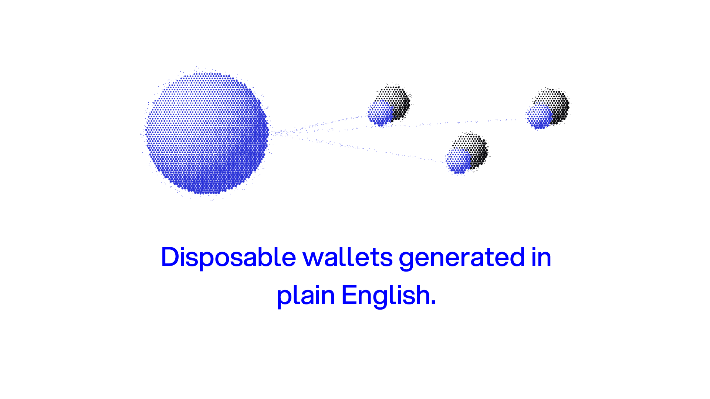
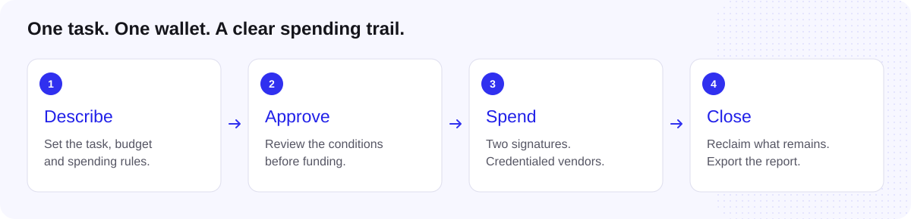

<p align="center">
  
</p>

# Disposable wallets for AI agents

**Give your agent a task and a budget. Keep control of the money.**

Cereal turns a plain-English instruction into a dedicated agent wallet on the XRP Ledger. Each wallet has its own budget, spending rules, and payment history. Agents can buy from approved vendors; owners can track spending, reclaim leftovers, and export an accounting report.

Built at the **AI & Fintech XRPL Hackathon · New York · October 24–25, 2026**, by **Roy Li, Om Ivatury, and Andrew Paik**. All native XRPL payment flows use **testnet**.

[View the slide deck](https://www.figma.com/slides/NpXC14z2S6mEGStvxI4eVr/cereal-xrpl) · [Try the interface](#try-the-interface) · [Read the demo script](docs/DEMO-SCRIPT.md)

## Why Cereal?

An agent needs enough money to finish its job. Giving it access to a shared treasury also gives a mistaken or compromised agent more money to lose.

Cereal gives each task a separate wallet funded with its allocated budget. Spending requires the agent and Cereal to sign together, while Cereal checks vendor credentials and the owner's rules before co-signing. The wallet balance bounds the funds available to that task.

<p align="center">
  
</p>

## From instruction to spending report

> “Give the research agent 20 RLUSD for data vendors until tomorrow.”

Review the proposed conditions, approve the budget, and fund the wallet. The agent works within those conditions while payments and refusals appear in its activity. When the job ends, remaining funds return to the treasury; eligible wallets can be retired.



| Control | What enforces it |
| --- | --- |
| **A separate budget per task** | The wallet receives its allocated RLUSD balance. Agents cannot top themselves up. |
| **Two signatures to spend** | XRPL multi-signing requires both the agent and Cereal for agent payments; the master key is disabled. |
| **Trusted vendors** | Cereal checks on-chain vendor credentials before co-signing. Owner restrictions can narrow the permitted set. |
| **Owner-defined rules** | The service checks expiry, approval requirements, and spending conditions. |
| **A traceable record** | Tagged transactions connect payments to jobs and an accounting CSV. |

Budgets and signing requirements are enforced by the ledger. Vendor checks and spending policies are enforced by Cereal's co-signing service. A payment is treated as settled only after validated transaction evidence confirms it.

## Try the interface

```sh
cd frontend
npm ci
npm run dev:mock
```

Open **http://127.0.0.1:5180**. Explore wallets, adjust demo budgets, and inspect simulated activity. AI rule editing requires the backend service and a model API key.

For a fully offline walkthrough, open **Settings → Developer tools → Offline fixtures**. For connected testnet tasks, use **Open test chat** with the backend running. See the [chat walkthrough](docs/RESEARCH-CHAT-DEMO.md) for what is simulated and what can spend testnet funds.

## Run on XRPL testnet

**Requires:** Python 3.10+, Node.js/npm, and `make`.

```sh
make setup
cp .env.example .env
make pool
make preflight
make service
```

Keep wallet seeds and API keys in your local `.env`. Configure the accounts, funding, and vendor credentials using the [build guide](docs/BUILD-ORDER.md). The service runs on port **8001**.

In another terminal, start the connected interface:

```sh
cd frontend
npm ci
npm run dev
```

Run offline backend tests with `make test`. Live acceptance tests are opt-in and spend testnet funds; see the build guide before running them.

## Under the hood

**Python · FastAPI · xrpl-py · x402 · React · TypeScript**

| Directory | Purpose |
| --- | --- |
| [`cereal/`](cereal/) | Wallet lifecycle, co-signing, agent tools, and accounting exports |
| [`frontend/`](frontend/README.md) | Wallet interface, spending rules, and research chat |
| [`x402/`](x402/) | Paid vendor endpoints and a reference payment client |
| [`ledger/`](ledger/README.md) | Hardware signing and recovery tooling |
| [`docs/`](docs/) | Architecture, demo walkthroughs, and integration research |

Partner support varies by integration. The [partner documentation](docs/partners/README.md) records implementation boundaries and open questions; XRPL EVM flows are separate from native XRPL.

[Product & architecture](docs/PROJECT.md) · [Build guide](docs/BUILD-ORDER.md) · [Demo script](docs/DEMO-SCRIPT.md) · [Frontend guide](frontend/README.md)
