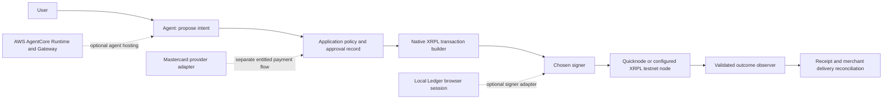

# Integration architecture for cereal-xrpl

**Status:** proposed integration design, grounded in the October 24, 2026 research. The repository currently implements a small Python native-XRPL x402 demo. Partner connections described here are not implemented by this documentation change.

## Existing application

The reviewed baseline is `omexe/cereal-xrpl` commit `e90b994e5972030ed2c05c7809d66eb45a2d62ee`. Its stack is Python, `xrpl-py`, `x402-xrpl`, FastAPI, requests and python-dotenv. Dependencies are unpinned. `scripts/new_wallet.py` creates/funds a testnet wallet, `scripts/send_payment.py` sends XRP, `x402/server.py` protects `/hello`, and `x402/client.py` pays a 402 challenge through T54's requests wrapper. `/health` is free. [Repository](https://github.com/omexe/cereal-xrpl)

The merchant uses `network="xrpl:1"`, `asset="XRP"`, a configured drops price, a merchant address and a facilitator URL. The payer loads a software wallet from `XRPL_BUYER_SEED` and uses `x402_requests` with `scheme_filter="exact"` and `network_filter=None`. The project instruction is **XRPL testnet only**. `None` does not enforce that instruction; before exposing automatic payments to untrusted services, inspect the installed wrapper's filter types and explicitly restrict accepted network, asset, payee, facilitator and price. Documentation alone does not apply that restriction.

The baseline mirrors the [native XRPL x402 guide](https://xrpl.org/docs/agents/agentic-payments-x402). That guide describes merchant, payer and facilitator roles. Treat the facilitator's proof/receipt contract as part of the protocol; do not substitute an unrelated transaction hash for the expected payment payload. Header names and encodings depend on protocol/package version. Record the installed version and capture a local test fixture before extending the wrapper. The guide's examples include `X-PAYMENT` and `PAYMENT-RESPONSE`; these are not a universal promise about every x402 version.

## Separation of responsibilities



The solid path is the intended native XRPL payment architecture. Dashed integrations are alternatives/extensions. The diagram does not imply that the current demo already has policy storage, Ledger support, AWS deployment or Mastercard execution.

Use Quicknode as the node transport for native XRPL. Keep Ledger signing local to a browser/device session. AWS can host reasoning and narrow application tools, but a cloud container cannot directly control the user's USB wallet. Mastercard is a separately entitled payment provider, not a required step in every XRPL transfer. AWS Payments is another wallet/provider path; it is not the native XRPL implementation. See [Ledger](ledger.md), [Quicknode](quicknode.md), [Mastercard](mastercard.md) and [AWS](aws.md).

## Native XRPL transaction lifecycle

1. **Validate intent.** Require an authenticated actor and exact network, source account, destination, destination tag if required, asset, integer drops amount, fee ceiling and expiration. Use decimal parsing for user-facing XRP. Never convert a money amount through binary floating point. The baseline send script currently does so; replacing it is a follow-up implementation task.
2. **Read current state.** Obtain validated account/ledger information, network fees and sequence. Serialize outgoing transactions per account or deliberately implement sequence allocation. Re-read current reserve requirements instead of relying on constants in an old tutorial or vendored skill.
3. **Build a bounded proposal.** For a basic XRP transfer, use `Payment`, `Account`, `Destination`, string drops `Amount`, `Fee`, `Sequence`, `LastLedgerSequence`, and the appropriate signing public key. Add `DestinationTag` when required. Preserve a normalized intent plus the exact transaction bytes/hash that approval covers. Do not add issued-token paths or partial-payment flags to a basic transfer.
4. **Authorize and sign.** Enforce policy before handing bytes to a signer. For Ledger, follow the pinned XRP signer package's actual types and the workshop's serialization convention; do not mix normal transaction encoding with the signing prefix. Match the derived public key/address to the selected source account. A rejection or disconnected device returns an unsigned/canceled state.
5. **Submit once per logical operation.** Save the signed transaction hash before broadcast and track the submission response. A timeout after submission creates an ambiguous outcome. Reconciliation comes before creating a replacement payment.
6. **Resolve validation.** Query `tx` or consume a notification and verify it through a trusted node. Require `validated: true` and inspect `meta.TransactionResult`. Check transaction contents against the approved proposal. Pending, absent and temporarily unreachable are distinct from final failure.
7. **Reconcile delivery.** Match the validated payment to the x402/facilitator receipt and the merchant's actual response. A ledger payment can succeed while resource delivery fails. Retry delivery only according to the protocol's proof reuse/idempotency contract; do not automatically pay twice.

Protocol sources: [Payment fields and flags](https://xrpl.org/docs/references/protocol/transactions/types/payment), [transaction results](https://xrpl.org/docs/references/protocol/transactions/transaction-results), [finality](https://xrpl.org/docs/concepts/transactions/finality-of-results), [tx lookup](https://xrpl.org/docs/references/http-websocket-apis/public-api-methods/transaction-methods/tx).

### Result semantics and amounts

`tesSUCCESS` in a provisional submit response is not final settlement. A validated `tesSUCCESS` establishes successful transaction execution. A validated `tec` result is a failed transaction that can still consume a fee and sequence; it must not be described as “nothing happened.” Other result classes require their specific retry/finality rules. `txnNotFound` alone does not prove a payment can safely be recreated. After expiration, establish validated ledger progress and sufficient history coverage before declaring the old transaction absent. Do not blindly retry a sequence error with a fresh payment. [Finality rules](https://xrpl.org/docs/concepts/transactions/finality-of-results)

For a successful Payment, reconcile the actual `delivered_amount`, especially if supporting partial payments. Do not credit the nominal requested amount from an attacker-controlled transaction. Native XRP amounts are integer drops strings; issued assets use an issuer/currency/value structure. XRPL API v2 uses `DeliverMax` for the field called `Amount` in v1; use the SDK/API version's supported shape and never send both. The payment examples in this repo use the library's `Amount` form. [Payment reference](https://xrpl.org/docs/references/protocol/transactions/types/payment)

## Proposed durable state model

```text
draft -> policy_checked -> awaiting_approval -> approved -> signed
      -> submitted -> pending -> validated_success -> delivery_complete
                            \-> validated_failure
                            \-> expired_unincluded (only with evidence)

Any uncertain network/provider outcome -> unknown -> reconcile
Before submission: denied | canceled | expired
After payment success: delivery_pending | delivery_failed (payment remains succeeded)
```

This is an application design, not an XRPL or Mastercard state enumeration. Store original provider/ledger result codes as well as normalized states. At minimum persist intent ID, actor, network, source/destination/tag, asset/amount, policy version, approval reference, proposal digest, sequence, last-ledger bound, transaction hash, ledger index, result code, actual delivered amount and delivery outcome. Avoid storing secrets or complete sensitive provider proofs in ordinary logs.

An application idempotency key deduplicates the business request in our database. It does not automatically become a supported Mastercard header, an AWS payment token, or a guarantee from an x402 wrapper. Use each provider's documented mechanism and preserve its operation ID. The same signed XRPL transaction has the same hash, but rebuilding it with a new sequence can create a second payment.

## Ledger integration boundary

The existing `x402_requests` takes a software wallet. It is **not verified to accept an asynchronous external hardware signer**. Inspect the exact package implementation and supported extension points before changing it. A plausible design is an unsigned proposal from the Python service, a local TypeScript browser component that displays/approves and signs with DMK, and a backend submit/reconcile adapter. The browser must verify the proposal's actor, destination, amount, network and expiry independently of model prose. Submission authorization must bind the approved proposal to the signed transaction.

Resolve the documented DER-byte versus `{r,s,v}` signer discrepancy first. Native XRPL Clear Signing was not offered by the inspected hackathon guide; do not promise complete semantic transaction display on the device. Hardware approval proves a signing interaction, not successful settlement or correct merchant delivery. [Ledger details and workshop](ledger.md)

## Event processing boundary

RPC polling, WSS subscriptions and Quicknode Streams/Webhooks are different transports. Webhook receivers should verify the documented HMAC against the exact uncompressed message, reject replays, enqueue durably, acknowledge promptly and process idempotently. Deduplicate by network plus transaction/event identity. Verify the ledger outcome before granting value. WSS connections can drop, and notifications may be duplicated or reordered; persist a cursor and recover missing history using the available node/archive range. [Quicknode contracts](quicknode.md)

## Suggested implementation order

1. Pin Python dependencies and verify the existing local testnet x402 loop. Capture requirements/proof/receipt shapes with secrets redacted.
2. Add explicit payment policy, exact money parsing, durable attempt state and reconciliation. Restrict the payer to testnet and the intended resource/provider.
3. Switch the configurable testnet RPC to a Quicknode testnet endpoint and verify HTTP/WSS behavior. Add webhook ingestion only when asynchronous events are needed.
4. Prove Ledger address derivation and one manually approved testnet Payment using pinned workshop-compatible packages. Then design the x402 signer bridge.
5. Host the payer on AgentCore if cloud deployment serves the demo; retain explicit payment tools and a separate merchant/facilitator boundary.
6. Integrate Mastercard only after receiving an entitled sandbox operation contract. Keep simulations labeled and distinct from the real XRPL testnet receipt.

These are follow-up engineering steps; this documentation change does not execute them.

## Acceptance matrix for future implementation

| Scenario | Required behavior |
|---|---|
| Valid small testnet payment | One approved transaction; validated result and explorer hash; merchant delivery recorded |
| Mainnet or wrong asset challenge | Denied before signing |
| Unexpected destination / oversized amount | Denied against explicit policy |
| Ledger rejection/disconnect | No broadcast; recoverable UI state |
| Fee/sequence changes during approval | Proposal invalidated or deliberately rebuilt and reapproved |
| Submit timeout / `tefPAST_SEQ` | Reconcile original hash and sequence before replacement |
| Validated `tec` | Failed payment with recorded fee/result, no delivery credit |
| Duplicate or tampered webhook | No duplicate accounting; invalid HMAC rejected |
| Partial payment below required price | Credit actual delivery only; do not release underpaid resource |
| Merchant timeout after payment | Preserve payment success and retry/reconcile delivery separately |
| Prompt/tool output asks to bypass policy | Deterministic tool boundary rejects it |
| Mastercard unavailable or unentitled | Explicit unsupported/simulated state, no fabricated API success |

No integration test in this matrix was run during documentation research.
