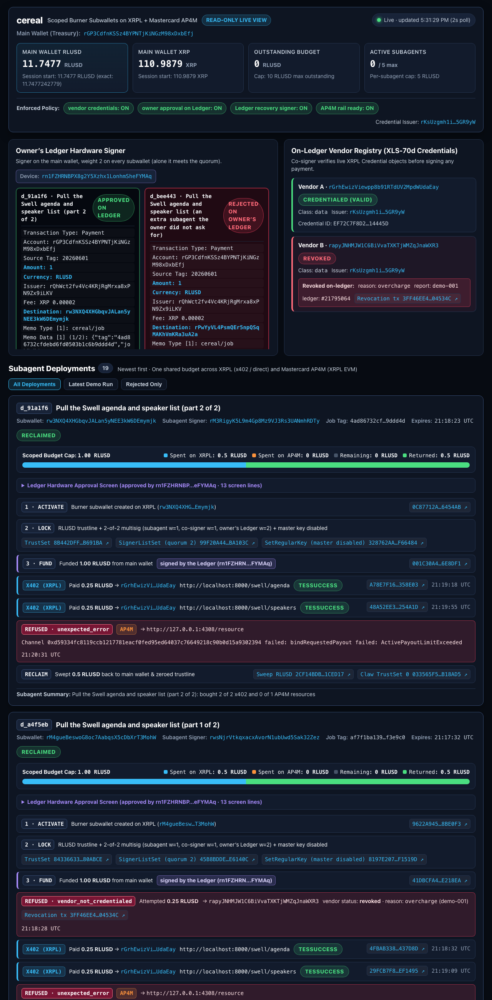

# Cereal Read-Only Projector Dashboard (`web/`)

Live, read-only web dashboard for **cereal** (Part 5). Designed for a 1280px+ projector during the 3-minute demo:
- **Header:** Main wallet (`address`, `rlusd` and `xrp` balances with live session delta, `outstanding_budget`, `active_subagents`, `caps`) and policy badges (`vendor credentials`, `owner approval on Ledger`, `Ledger recovery signer`, `AP4M rail ready`).
- **Owner's Ledger Panel:** Displays the hardware device address (`rn1FZHRNBPX8g2Y5Xzhx1LonhmSheFYMAq`), its role (*"Signer on the main wallet, weight 2 on every subwallet (alone it meets the quorum)"*), and each deployment's hardware OLED screen lines (`approval.screens`) with the approval outcome (`approved` or `owner_rejected`).
- **On-Ledger Vendor Registry:** Live XLS-70 credential status for Vendor A (`rGrhEwizViewpp8b91RTdUV2MpdWUdaEay`, credentialed) and Vendor B (`rapyJNHMJW1C6BiVvaTXKTjWMZqJnaWXR3`, revoked on-ledger with revocation reason, report, and transaction link).
- **Subagent Cards (Newest First):** Task, status chip (`deploying`, `active`, `reclaimed`, `recovered`, `retired`, `rejected`, `failed`), clickable XRPL Testnet explorer links for `subwallet` and `subagent`, and a multi-rail budget bar (**Spent on XRPL**, **Spent on AP4M**, **Remaining**, **Returned**).
- **Per-Card Lifecycle Timeline:** `activate`, `lock` (TrustSet + SignerListSet quorum 2 + AccountSet master disabled), `fund` (*"signed by the Ledger"* when `approval` exists), chronological `payments` (`x402`, `direct`, and `ap4m` with XRPL / XRPL EVM explorer & receipt links), red `refusals` with on-ledger revocation evidence links, `reclaim`, `recover` (*"owner's Ledger alone"*), and `retire`.
- **Rejected Deployments:** Highlights *"rejected on the owner's Ledger"*, renders the exact device screen lines, and shows `0 transactions sent`.

## Run in One Command

With the `cereal` service running on `http://localhost:8001`:

```bash
npm --prefix web run dev
```

Then open **http://127.0.0.1:5173** in your browser.
- `server.mjs` proxies `GET /api/*` to `http://127.0.0.1:8001/*` (configurable via `CEREAL_API_URL` and `PORT`).
- All non-`GET` requests to `/api/*` are rejected with `405 Method Not Allowed` (`{"ok":false,"refused":"read_only_dashboard"}`), guaranteeing the dashboard cannot deploy, pay, reclaim, or revoke anything.

## Live Screenshot


